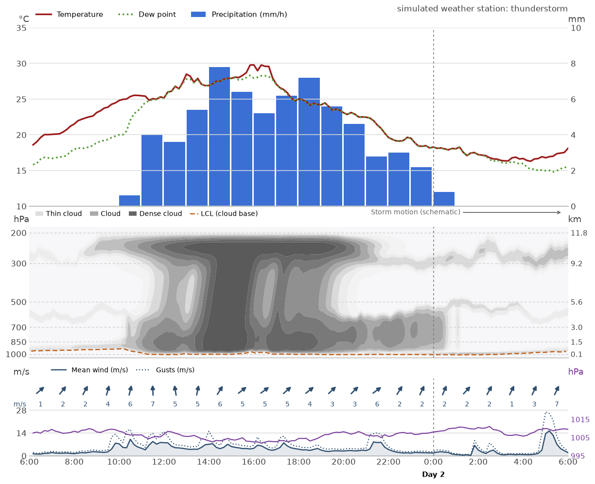
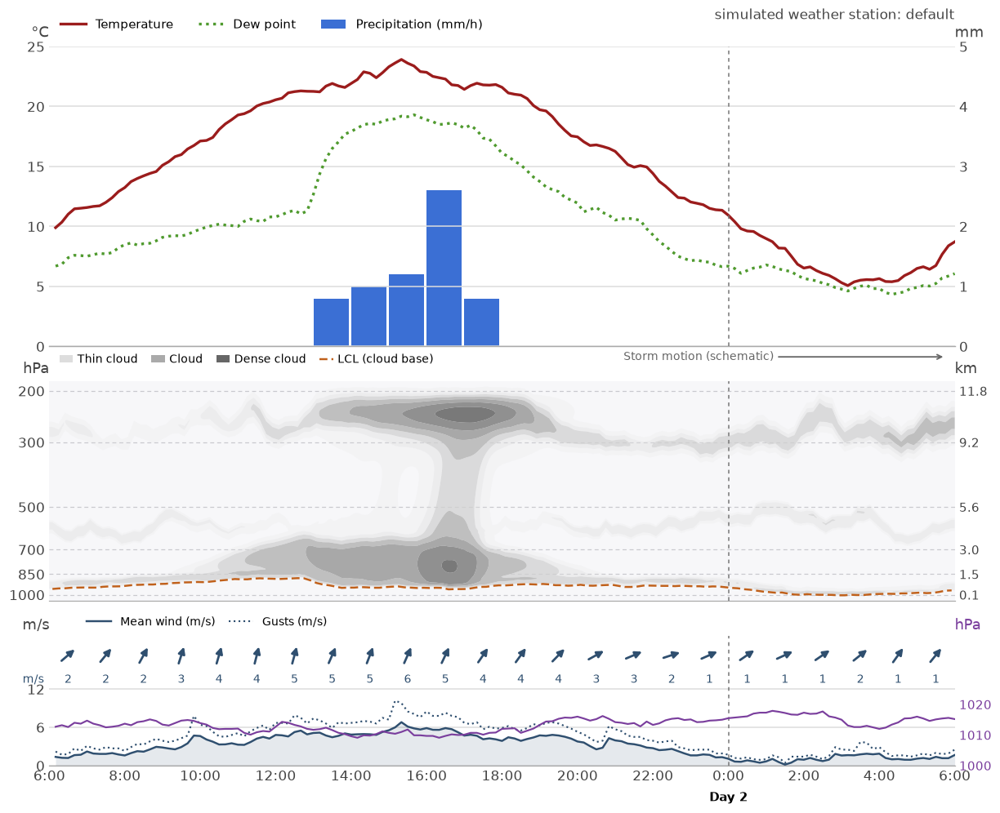
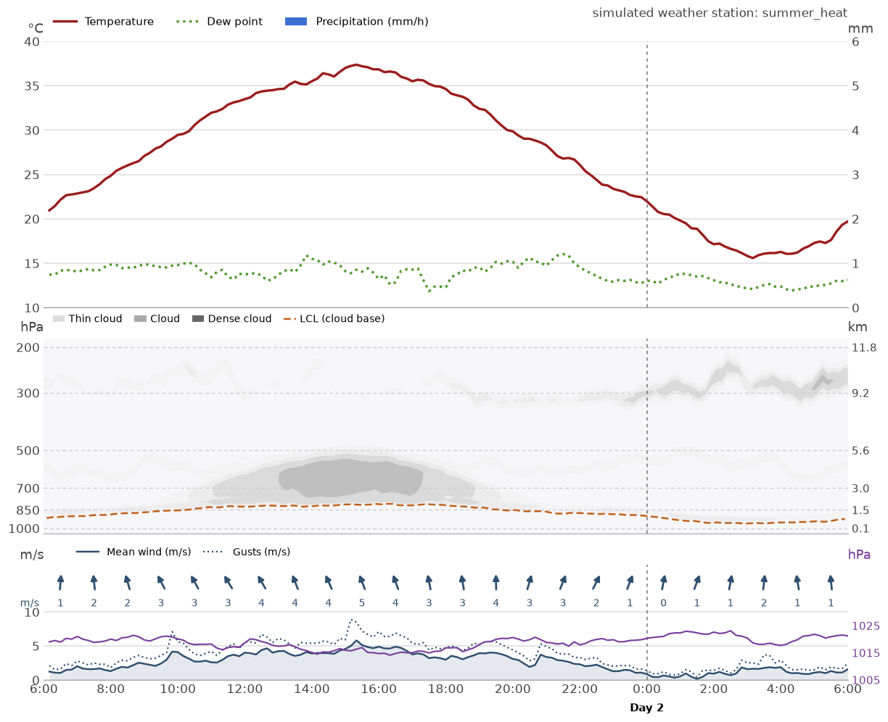
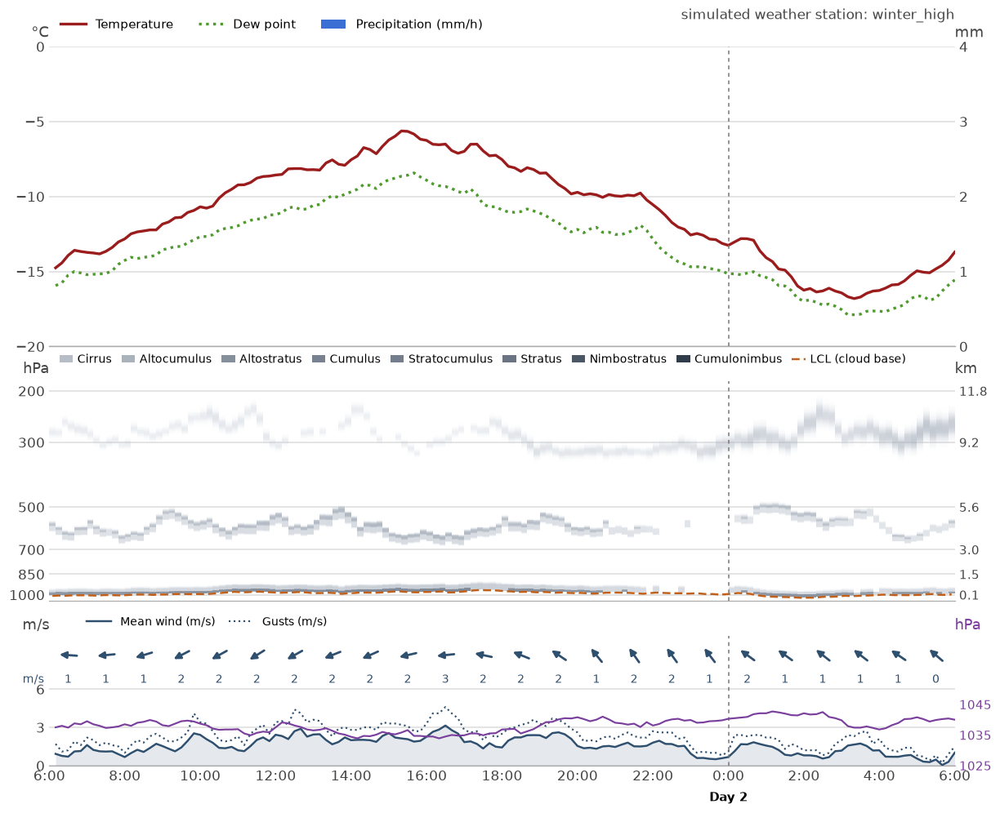
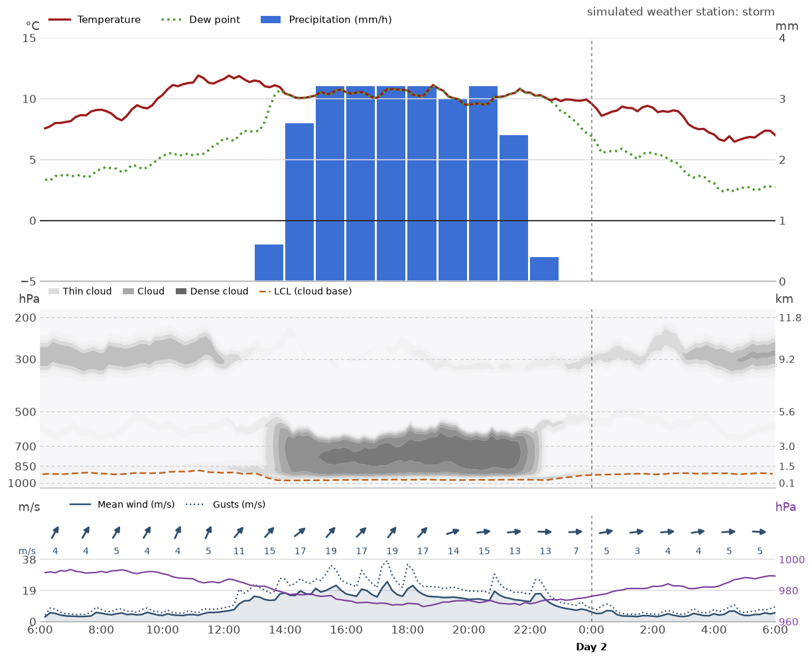
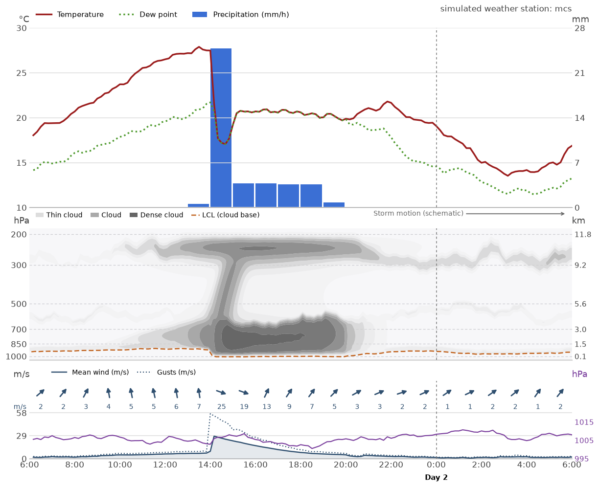
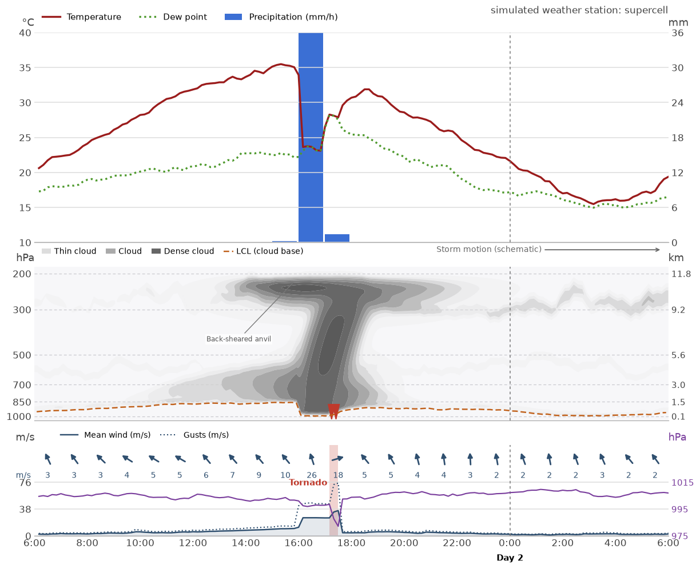

[](https://github.com/mattilaa/microcontroller_weather_station_simulator/actions/workflows/ci.yml)

# Microcontroller weather station simulator using QEMU

A bare-metal AArch64 program (no operating system) that runs a microcontroller-style
main loop on QEMU's `virt` machine (Cortex-A53). MLang implements the weather model,
sensors, record aggregation and packing, application protocol, console commands,
reports, integer formatting, boot settings, and scheduling policy. MLang also
implements the hardware drivers, networking, static storage, and freestanding
memory routines. MLang modules with inline assembly provide CPU startup and a small set of
ABI/linker symbol adapters. CMake builds them into one firmware image.

Its simulated sensors measure temperature, humidity, wind speed and direction, rain,
cloud cover, and cloud layers. Readings are printed on the UART, logged, and served
over **Ethernet** through a virtio-net driver and a minimal IPv4 stack (ARP, ping, UDP).
A Python tool imports the log and plots it in the style of the Finnish Meteorological
Institute's forecast chart, with Windy-style cloud shading:

**Scenario `thunderstorm`**: a hot, humid day. Anvil cirrus spreads ahead of the
cumulonimbus, then afternoon cloudbursts and gusts.

[](docs/scenarios/thunderstorm.png)

All seven scenario charts use the same cloud shading. The other scenarios,
one simulated day each from 06:00 (made with
`python tools/weather_tool.py demo --scenario <name>`; see [Weather scenarios](#weather-scenarios)):

<table>
<tr>
<td width="50%"><b>Scenario <code>default</code></b>: temperate, afternoon showers from two cumulonimbus<br></td>
<td width="50%"><b>Scenario <code>summer_heat</code></b>: up to 37 °C, dry, afternoon cumulus<br></td>
</tr>
<tr>
<td width="50%"><b>Scenario <code>winter_high</code></b>: −17 to −6 °C under 1040 hPa, calm, low stratus<br></td>
<td width="50%"><b>Scenario <code>storm</code></b>: cirrus all morning, then the deep low's gales and rain<br></td>
</tr>
<tr>
<td width="50%"><b>Scenario <code>mcs</code></b>: an extreme gust front, then hours of trailing rain as the wind dies<br></td>
<td width="50%"><b>Scenario <code>supercell</code></b>: extreme wind for the whole storm, a tornado at its end<br></td>
</tr>
</table>

## Installation

Run these commands from the repository root. Use Python 3.11 or newer.

### Linux (Debian/Ubuntu)

```sh
sudo apt-get update
sudo apt-get install -y build-essential git cmake ninja-build \
  clang llvm-dev lld flex bison libssl-dev qemu-system-arm \
  python3 python3-venv netcat-openbsd
```

### macOS (Homebrew)

```sh
brew install cmake ninja qemu llvm lld flex bison openssl
```

### Build and run (both platforms)

```sh
python3 -m venv .venv
source .venv/bin/activate
python -m pip install -r tests/requirements.txt
./build.sh -G Ninja
cmake --build build --target run
```

Press `q` to quit QEMU, or Ctrl-A X. Activate `.venv` in each new terminal.
The complete command sheet from [howto.txt](howto.txt) is included
[below](#command-reference).

## MLang toolchain

`./build.sh` fetches and builds [MLang v0.4.5](https://github.com/mattilaa/mlang/releases/tag/v0.4.5)
in the ignored `subprojects/mlang` directory before building the firmware.
The dependency is checked out at the release tag; builds do not follow `main`.
Existing clean `main` or v0.4.4 checkouts are migrated to v0.4.5.
Modified checkouts and other development branches are preserved.
Use `./bootstrap.sh` to build only the compiler, or
`BUILD_DIR=build-release ./build.sh -G Ninja -DCMAKE_BUILD_TYPE=Release`
for a Release build.

Direct `cmake -B build -G Ninja` also bootstraps MLang when its compiler is missing.
Subsequent firmware builds recompile changed `.mla` modules automatically.
Builds also generate `mlang_commands.json` in the build directory and copy it
to the project root for MLang editor tooling. This works with custom build
directories too; `cmake --build build --target mlang_commands` refreshes the
database without linking the firmware. The generated files are ignored by Git.

The firmware implementation lives in `src/`, rooted at `main.mla`.
No C++ firmware sources are compiled. Static globals and `fixedarray<T, N>` hold
the log, scheduler state, packet buffers, and aligned virtio DMA queues. Climate
presets are initialized statically; model seeds and sensor settings are applied
explicitly from `main`, preserving the previous deterministic simulation.
`tools/compile_mlang.py` emits LLVM IR and compiles it for
`aarch64-none-elf` with strict alignment and general registers only. It supplies
a non-throwing runtime in the same IR module so LLVM removes MLang's default
exception frames. The final LLVM pass optimizes for size (`-Oz`). Pointer-check
failures enter the firmware panic handler.
The firmware links no hosted MLang runtime and has no heap. Use
`fixedarray<T, N>` for allocation-free storage; existing list and `array<T, N>`
literals still allocate.

To test compiler development without changing the fetched release checkout:

```sh
MLANG_ROOT=../mlang BUILD_DIR=build-mlang-dev ./build.sh -G Ninja
```

CMake also accepts `-DMLANG_ROOT=/absolute/path/to/mlang`. An explicit checkout
is built in place and is not fetched or switched by bootstrap.

## Real time and the speed switch

By default the simulation runs in **real time**: the station samples its sensors every
second, and simulated time passes as fast as real time. Day 1 starts at 06:00.

Like a real automatic weather station, it logs **10-minute records**. Each record holds
the time-weighted means of the samples in its interval (wind direction averaged on the
circle) and the rain that fell in it, and is stamped with the interval's end time: the
06:10 record covers 06:00–06:10.

To avoid waiting 48 hours for 48 hours of data, set the **speed switch** to any value from
1 to 72000 (simulated seconds per real second):

| Speed | One real second is | 48 simulated hours take |
|-------|--------------------|-------------------------|
| 1 (default) | 1 s (real time) | 48 hours |
| 600 | 10 minutes | under 5 minutes |
| 3600 | 1 hour | under a minute |
| 72000 | 20 hours | under 3 seconds |

- **QEMU command line:** `-fw_cfg name=opt/weather/speed,string=600`. The firmware reads
  it at boot through QEMU's fw_cfg device.
- **CMake `run` target:** `cmake -B build -DSIM_SPEED=600`.
- **While running:** the UDP command `speed 600`, or the console keys `+`/`-` (1, 10, 60,
  600, 3600, 72000).
- **Plotting tool:** `record --speed 600`.

The weather model steps once per simulated minute at every speed, so the weather
behaves the same at 1× and at 72000×. Every sample is still taken from the model
(at most one simulated minute apart). At 72000× each one-second update simulates 1200
minutes, which takes the firmware a few milliseconds, so the console and network stay
responsive.

At 72000× the station logs 120 records per second, and its 256-record log wraps in about
2 seconds. `record` picks its import interval from the speed (0.53 s at 72000×), so it
keeps up. `fetch`, and `record` with a too-long `--interval`, warn when records are lost.

## Weather scenarios

The simulation can run different climates. Each scenario sets the model's means and
strengths: temperature and its daily swing, humidity, cloudiness, convection, rain, wind,
gusts, how the wind turns, and surface pressure.

| Scenario | Weather | One simulated day (measured) |
|----------|---------|------------------------------|
| `default` | temperate, showers now and then | 5–24 °C, a few mm of rain, ~1013 hPa |
| `summer_heat` | very hot summer day, dry and mostly clear, afternoon cumulus | 20–36 °C, humidity down to ~22 %, no rain, ~1018 hPa |
| `winter_high` | cold winter high pressure: calm, clear, frost fog/stratus at night, no convection | −16 to −8 °C, 1031–1044 hPa, wind under 3 m/s |
| `storm` | severe storm: a deep low passes. A calm morning under the low's thickening cirrus shield, then (about 6 hours after the switch) gales, overcast nimbostratus, heavy rain and wind veering SSW → NW, clearing as the low fills | ~966 hPa at its deepest, ~4 m/s under ~90 % cirrus before it, then 15–24 m/s with gusts to ~37 m/s, ~25 mm of rain |
| `thunderstorm` | hot, humid day: anvil cirrus spreads about 2 hours ahead of towering cumulonimbus cells (each lasting tens of minutes), cloudbursts, gusts, rain cooling | 15–28 °C, cirrus ~90 % before the storm, cumulonimbus up to ~65 %, gusts to ~13 m/s |
| `mcs` | an approaching mesoscale convective system (8 hours after the switch): its anvil cirrus spreads for ~5 hours ahead; the gust front brings the most extreme wind, a cold outflow, a pressure jump and a line of cumulonimbus with a cloudburst; then ~5 hours of trailing nimbostratus rain as the wind dies down, and a wake low | ~25 m/s at the gust front with gusts to ~55 m/s, ~6 m/s four hours later, ~8 °C cooling, ~40 mm of rain |
| `supercell` | a supercell (10 hours after the switch): an isolated anvil and strengthening southeasterly inflow for ~4 hours, then 90 minutes of one rotating cumulonimbus tower with extreme wind throughout, torrential rain and hail in its forward flank, and a tornado in its last 15 minutes. It clears quickly behind | ~25 m/s for the whole storm, ~35 mm of rain in an hour, the tornado: gusts to ~75 m/s and a ~20 hPa pressure drop |

How to choose one:
- **QEMU command line:** `-fw_cfg name=opt/weather/scenario,string=storm`, read at boot like
  the speed switch.
- **CMake `run` target:** `cmake -B build -DSIM_SCENARIO=storm`.
- **While running:** the UDP command `scenario storm` (`scenarios` lists them all), or the
  console key `c`.
- **Plotting tool:** `demo --scenario storm`, `record --scenario storm`.

Switching jumps the slow random processes to the new climate's means; the clock carries on.
`default` reproduces the original weather exactly, with the same random sequence.

A barometer measures the surface pressure (0.1 hPa). It drifts around the scenario's mean,
and a storm's low deepens over 12 hours and fills over the next 12. The storm's cloud, rain
and wind arrive with the falling pressure: before them, only its cirrus shield. The cloud base (LCL) is
computed from the actual surface pressure, and the chart's wind panel shows the pressure on
a right-hand hPa axis.

## Weather simulation

| Quantity | Model |
|----------|-------|
| Temperature | daily sine cycle, 15 °C ± 8 °C (coldest ~03:00, warmest ~15:00), plus a slowly drifting "weather front" offset of up to ±3 °C |
| Humidity | falls about 3 %RH per °C of warming (relative humidity drops as air warms), plus its own slow moisture drift |
| Wind speed | pulled toward a daily mean (1–5 m/s, windiest in the afternoon) with random variation, plus occasional gusts that decay |
| Wind gusts | the peak (3-second) wind is 10–40 % above the wind of the moment, varying minute by minute. Each 10-minute record keeps the highest peak, which comes out around 1.45× its mean wind, a typical gust factor over land |
| Wind direction | a prevailing direction (starting SW) that drifts slowly; the vane swings ~30° in calm air but only a few degrees in strong wind |
| Cloud cover | low and middle cloud follows a slowly wandering trend; showers build and clear over hours. The sky imager reports total cover in whole percent, counting thin cirrus half |
| Cloud layers | the cloudiness is split into ten types, each at its own level. Splitting it leaves the total, and so the rain, unchanged |
| High | **cirrus**, wispy ice cloud drifting around 270 hPa (10 km). It thickens ahead of storms: a frontal low's cirrus shield spreads hours before its rain (lower, toward 330 hPa), and a thunderstorm's anvil spreads about 2 hours before its cumulonimbus (higher, toward the tropopause) and thins slowly after it |
| Middle | **altostratus**, a sheet drifting around 580 hPa (4.5 km), and **altocumulus**, patchy and lumpy just above its middle, more of it in the daytime |
| Low | **stratus**, a shallow grey sheet just above the cloud base in very humid air (down to fog); **stratocumulus**, a lumpy low layer in less humid air |
| Rain cloud | **nimbostratus** in steady, non-convective rain, from the cloud base up into the middle deck |
| Convective | **cumulus**, growing from the cloud base with afternoon convection and gone at night; **cumulonimbus**, in heavy convective rain, from the cloud base right up to the tropopause (200 hPa) |
| Thickness | each layer is thicker the more of it there is |
| Cloud base (LCL) | the lifting condensation level, from humidity: about 125 m per °C of dew-point spread, converted to hPa with a standard-atmosphere table. It's low in humid air and rain, and higher on dry afternoons |
| Rain | falls when cloudiness passes a threshold, harder the cloudier it gets (up to ~5 mm/h); clouds flatten the daily temperature swing, rain cools the air, and humidity builds up during rain and dries out over the following hours |

The slow parts are mean-reverting random processes (Ornstein–Uhlenbeck style). Each
sensor then adds its own noise and rounds to its resolution, as a real instrument
would. The rain gauge is a tipping bucket: it reports rain only in whole 0.2 mm tips. Without floating point, `sin()` is an integer approximation (Bhaskara I).
Wind direction is averaged on the circle, so 350° and 10° average to 0°, not 180°.

## Network

The firmware probes the 32 virtio-mmio slots for a virtio-net device. It needs the
modern virtio interface (`-global virtio-mmio.force-legacy=false`). It uses the static
address 10.0.2.15/24, which matches QEMU's user-mode network. The UDP weather service
listens on port 5000; each datagram is one command:

| Command | Reply |
|---------|-------|
| `weather` | the latest sample: `{"day":1,"time":"06:10:05","temperature":12.34,"humidity":71.20,"wind_speed":3.42,"wind_gust":4.90,"wind_direction":225,"wind_compass":"SW","rain":0.40,"rain_today":1.20,"cloud_cover":63,"lcl":912,"cirrus":25,"altostratus":20,"cumulus":30,"cumulus_top":650,"cumulonimbus":0,"cirrus_base":300,"cirrus_top":240,"altostratus_base":640,"altostratus_top":520,"stratus":5,"stratocumulus":12,"nimbostratus":0,"altocumulus":4,"stratus_top":880,"stratocumulus_top":830,"nimbostratus_top":520,"altocumulus_base":593,"altocumulus_top":552,"pressure":1013.2,"tornado":0,"speed":1,"scenario":"default"}` |
| `time HH:MM` | `ok time HH:MM`: jumps the simulated clock |
| `log [sequence]` | one page (up to 9 rows) of 10-minute records as CSV, from `sequence`; the header line `log next=N count=C` says where to continue |
| `advance MINUTES` | fast-forwards the simulation instantly (10…4320 minutes), logging the records |
| `speed [N]` | shows or sets the simulation speed (1…72000) |
| `scenario [name]` | shows or sets the weather scenario; `scenarios` lists them |
| `ping` | `pong` |
| `help` | the list of commands |

`cmake --build build --target run` forwards host UDP port 5555 to the service:

```sh
echo weather | nc -u -w1 127.0.0.1 5555
```

The firmware keeps the last 256 records (42.7 simulated hours) in its log.

## Importing and plotting the data

`tools/weather_tool.py` imports the log over UDP into a CSV file and plots it with
matplotlib, in the style of the [FMI forecast chart](https://www.ilmatieteenlaitos.fi/saa/helsinki?forecast=daily):

- **Top panel:** temperature (red), dew point (green, dotted, computed from temperature and
  humidity), and hourly precipitation bars on the right-hand mm axis.
- **Cloud panel** (with cloud layer data): a time-height cross-section on a log-pressure
  axis, 1000 hPa at the bottom to 200 hPa at the top, with km on the right.
  Windy-style grayscale contours show cloud density: pale edges, layered grey bands,
  and darker cores. Cloud amounts and base/top heights are interpolated between
  adjacent 10-minute records for display; missing record intervals stay blank.
  All cloud types contribute to the same shading, with denser cover appearing darker:
  - cirrus is wispy and densest in its middle, drifting around 10 km
  - altostratus is an undulating sheet, with patchy altocumulus in it
  - stratus and stratocumulus are low layers resting on the cloud base
  - nimbostratus is a dark rain cloud from the cloud base into the middle deck
  - cumulus has a flat base on the LCL and a soft, billowing top
  - cumulonimbus has a narrower convective core and a spreading upper anvil;
    stronger recorded gusts broaden the anvil and lower storm-base skirt

  Storm shapes are schematic profiles on the time axis. A rightward motion arrow
  defines the drawing convention: the base stays anchored while the core and
  anvil lean progressively in that direction, with stronger shear for severe
  storms. Supercells also have a smaller back-sheared anvil extending against
  that motion, labelled on the chart. Surface wind arrows retain their recorded
  compass directions. Logged readings and rainfall totals stay unchanged.

  The LCL (cloud base) is a dashed line, and a tornado is a red funnel to the ground.
- **Bottom panel:** wind. The solid line (with a light fill) is each 10-minute record's mean
  wind. The dotted line is its gust, the highest peak wind in the interval, so the two
  don't mix. Hourly arrows point where the wind blows to, with the hourly mean speed under
  each arrow. Surface pressure runs on the right-hand hPa axis. A tornado gets a red band
  and label.
- **Time axis:** a dashed line at each midnight.

With the [virtual environment](#build-and-run-both-platforms) set up and active:

```sh
# Record live: starts its own QEMU, imports records as they are measured and keeps
# weather.png up to date (Ctrl-C stops). --speed is the speed switch.
python tools/weather_tool.py record --speed 3600 --hours 48     # 48 h in under a minute
python tools/weather_tool.py record --speed 72000 --hours 72   # 72 h in ~5 s
python tools/weather_tool.py record --speed 600 --live          # also a live chart window
python tools/weather_tool.py record                             # real time

# Against an already running firmware (cmake --build build --target run):
python tools/weather_tool.py record --port 5555 --speed 600
python tools/weather_tool.py fetch --out weather.csv            # one import
python tools/weather_tool.py plot weather.csv --out weather.png --hours 24

# Instant: fast-forward without waiting at all.
python tools/weather_tool.py demo --firmware build/firmware.elf --minutes 2880 --hours 48
```

`demo` and `record` select the cloud profile from the firmware scenario. When
replotting a supercell CSV, use `plot weather.csv --scenario supercell` to retain
its back-sheared anvil, including records from before a tornado occurs.

The CSV columns are
`seq,day,time,temperature,humidity,wind_speed,wind_direction,rain,cloud_cover,lcl,cirrus,altostratus,cumulus,cumulus_top,cumulonimbus,cirrus_base,cirrus_top,altostratus_base,altostratus_top,stratus,stratocumulus,nimbostratus,altocumulus,stratus_top,stratocumulus_top,nimbostratus_top,altocumulus_base,altocumulus_top,pressure,wind_gust,tornado`
(cloud levels in hPa, cloud amounts in %, surface pressure in hPa with one decimal). Older CSVs without the newer columns at the end
still plot: without layer levels the cirrus and altostratus fall back to fixed levels, and
without any cloud columns there's no cloud panel.

`fetch` and `record` append only records that aren't in the CSV yet, so they can be run
repeatedly while the firmware keeps measuring. `record` with its own QEMU starts a fresh
CSV, because a fresh firmware starts a fresh log.

## Build options

The default toolchain uses LLVM/Clang and LLD to target AArch64. To use
Debian/Ubuntu's GNU cross compiler instead:

```sh
sudo apt-get install -y g++-aarch64-linux-gnu
cmake -B build-gcc -G Ninja \
  -DCMAKE_TOOLCHAIN_FILE=cmake/toolchain-gcc-aarch64.cmake \
  -DCROSS_PREFIX=aarch64-linux-gnu-
cmake --build build-gcc
```

CMake caches the Python interpreter selected during configuration. To switch an
existing build to the virtual environment, run:

```sh
cmake -B build -DPython3_EXECUTABLE="$PWD/.venv/bin/python"
```

## Tests

Robot Framework suites in `tests/` boot the firmware in QEMU and drive it over the
UART and over Ethernet:

| Suite | Covers |
|-------|--------|
| `boot.robot` | banner, EL1, network bring-up, running without a NIC, rejecting a legacy virtio device |
| `tasks.robot` | sensor timing, simulated clock rate |
| `console.robot` | every console command, history capping, averages, the quit exit code |
| `weather.robot` | value ranges, daily temperature cycle, humidity vs. temperature, wind behaviour, setting the clock, rain showers and tipping-bucket amounts, cloud cover in rain, cloud layers at their levels, afternoon cumulus, cumulonimbus only in rain-bearing cloud, high and middle layers drifting and thickening, stratus in humid air, nimbostratus only with rain-bearing cloud, lower cloud base in humid air, daily rain totals, the log and fast-forward |
| `realtime.robot` | real time by default, the QEMU speed switch, the fastest speed (72000×), changing speed over UDP and from the console, records as means of their samples |
| `scenarios.robot` | each scenario's character over a simulated day (heat, cold high pressure, storm cirrus first then low/gales/rain/veering, thunderstorm anvil cirrus first then cumulonimbus/cloudbursts), the boot switch, the commands and the console key |
| `tools.robot` | `weather_tool.py demo` and `record` end to end (QEMU, import over UDP, plot), recording at 72000× without losing records, and replotting a CSV |
| `ethernet.robot` | gratuitous ARP, ARP replies, ping (incl. large and 40 in a row), UDP commands, dropping corrupted or misaddressed packets |
| `image.robot` | load address, no RTTI, exception, heap or guard symbols, empty `.init_array`, flash size budget, RAM within 32 KiB, `.data` loaded from flash |

For Ethernet, `tests/libraries/network_peer.py` acts as a second host. QEMU's `dgram`
netdev carries each Ethernet frame as a UDP datagram between QEMU and the library. This
needs no root rights or TAP devices, and lets the tests build and check raw frames,
checksums included.

Portable MLang tests in `tests/firmware_unit_tests.mla` cover overlapping memory
moves, byte fills/copies/comparisons, unaligned packet fields, Internet checksums,
and log wraparound with exact sequence and packed-value checks. `ctest` runs these
alongside Robot; the helper builds the host runtime in the MLang checkout. They
can also be run with `python tools/test_mlang.py`.

Run `ctest --test-dir build --output-on-failure` with the virtual environment
active. Robot reports are written to `build/robot/log.html`; commands for
individual suites and tests are in the [command reference](#command-reference).

## Continuous integration

`.github/workflows/ci.yml` runs on every push to `main` and on every pull request, in three stages:

| Stage   | Jobs | What it does |
|---------|------|--------------|
| `lint`  | 1    | Python syntax checks and a Robot Framework dry run |
| `build` | 8    | host {Linux x64, Linux arm64} × {GCC, clang} × {Debug, Release}, built with `-DFIRMWARE_WERROR=ON`; runs portable MLang unit tests once and uploads the firmware as an artifact |
| `test`  | 8    | the same matrix; downloads the matching firmware and runs the Robot suites under QEMU, with no compiler installed |

MLang emits the complete firmware object, including startup and ABI assembly.
The GNU/Clang drivers link that object without compiling C++ firmware code. GCC on the x64 host is the `g++-aarch64-linux-gnu` cross compiler. On the arm64 host it's
Ubuntu's native `g++`. Both provide `aarch64-linux-gnu-*` binaries, so both use the same
`CROSS_PREFIX`. Robot logs are uploaded as artifacts too.

### Debugging

```sh
cmake --build build --target debug  # QEMU halts and waits for a debugger on :1234
lldb build/firmware.elf -o "gdb-remote 1234"
```

## Layout

```
CMakeLists.txt                      build flags, objcopy to .bin, run/debug targets, ctest
.github/workflows/ci.yml            GitHub Actions pipeline
tests/*.robot                       Robot Framework suites (boot, tasks, console, weather, ethernet, tools, image)
tools/weather_tool.py               import the reading log over UDP, plot it (matplotlib)
tests/libraries/                    Python keyword libraries: QEMU/UART driver, network peer, ELF checks
cmake/toolchain-clang-aarch64.cmake clang++ + lld toolchain (default)
cmake/toolchain-gcc-aarch64.cmake   aarch64-none-elf-g++ toolchain
linker/qemu_virt.ld                 memory map: FLASH at 0x40000000, 32 KiB RAM at 0x40100000
src/startup.mla                      _start: set up stack/RAM, park secondary cores, call main
src/runtime/abi.mla                  C runtime symbol aliases and linker-address accessors
src/main.mla                       station initialization and cooperative main loop
src/hal/hardware.mla               UART, generic timer, fw_cfg, MMIO and semihosting
src/hal/virtio_net.mla             aligned DMA queues and polled virtio-net driver
src/net/stack.mla                  Ethernet, ARP, IPv4, ICMP and UDP stack
src/net/bytes.mla                  byte-wise packet fields and Internet checksums
src/app/weather_scenario.mla       statically initialized climate presets
src/app/weather_model.mla          deterministic daily cycles and random processes
src/app/weather_station.mla        sensors, aggregation, packed records and fixed-capacity log
src/app/scheduler.mla              fixed task table and deadlines
src/util/text_stream.mla           UART output and bounded caller-owned reply buffers
src/app/weather_service.mla        UDP application command protocol
src/app/console.mla                console commands and simulation controls
src/app/reports.mla                weather reports and JSON/CSV formatting
src/util/text.mla                  allocation-free integer and text formatting
src/runtime/memory.mla             memcpy/memmove/memset/memcmp implementations
src/runtime/runtime.mla            stack high-water mark, panic and exit
src/util/fixed_math.mla            integer trigonometry, clamping and rounding
src/util/random.mla                deterministic PRNG and sensor noise
src/app/boot.mla                   boot speed/scenario configuration
tests/firmware_unit_tests.mla      portable MLang regression tests
tools/test_mlang.py                host-native test runner
```

## Command reference

From [howto.txt](howto.txt); choose the commands for the task you want to run.

```text
HOST PACKAGES (choose your platform)
  # Debian/Ubuntu:
  sudo apt-get update
  sudo apt-get install -y build-essential git cmake ninja-build clang llvm-dev lld flex bison libssl-dev qemu-system-arm python3 python3-venv netcat-openbsd
  # macOS:
  brew install cmake ninja qemu llvm lld flex bison openssl

SETUP (once, from the repository root)
  python3 -m venv .venv
  source .venv/bin/activate
  python -m pip install -r tests/requirements.txt
  ./build.sh -G Ninja              # fetch/build MLang v0.4.5, then firmware

RUN THE SIMULATION (real time; '+'/'-' change speed, 'q' quits)
  source .venv/bin/activate
  cmake --build build --target run
  cmake -B build -DSIM_SPEED=600 && cmake --build build --target run   # 10 min/s
  echo weather | nc -u -w1 127.0.0.1 5555           # in another terminal

WEATHER SCENARIOS (default, summer_heat, winter_high, storm, thunderstorm, mcs, supercell)
  python tools/weather_tool.py demo --scenario summer_heat     # very hot summer day
  python tools/weather_tool.py demo --scenario winter_high     # cold winter high pressure
  python tools/weather_tool.py demo --scenario storm           # cirrus first, then gales and a deep low
  python tools/weather_tool.py demo --scenario thunderstorm    # anvil cirrus, then afternoon thunderstorms
  python tools/weather_tool.py demo --scenario mcs             # anvil cirrus, extreme gust front, trailing rain
  python tools/weather_tool.py demo --scenario supercell       # extreme winds all storm, tornado at the end
  python tools/weather_tool.py record --scenario storm --speed 3600 --hours 24   # live
  cmake -B build -DSIM_SCENARIO=storm && cmake --build build --target run        # in QEMU
  # while running: console key 'c' cycles, or: echo "scenario storm" | nc -u -w1 127.0.0.1 5555

RECORD AND PLOT LIVE MEASUREMENTS (own QEMU; Ctrl-C stops; -> weather.png)
  python tools/weather_tool.py record                           # real time
  python tools/weather_tool.py record --speed 3600 --hours 48   # 48 h in < 1 min
  python tools/weather_tool.py record --speed 72000 --hours 72   # ~5 s
  python tools/weather_tool.py record --speed 600 --live        # live window

PLOT FROM THE RUNNING FIRMWARE ('run' target above)
  python tools/weather_tool.py record --port 5555               # keep collecting
  python tools/weather_tool.py fetch --out weather.csv          # one import
  python tools/weather_tool.py plot weather.csv --out weather.png

TESTS
  source .venv/bin/activate
  cmake --build build
  ctest --test-dir build --output-on-failure        # report: build/robot/log.html
  python tools/test_mlang.py                      # portable memory/packet/log checks
  robot --pythonpath tests/libraries tests/weather.robot          # one suite
  robot --pythonpath tests/libraries --test "Quit*" tests         # one test
```
